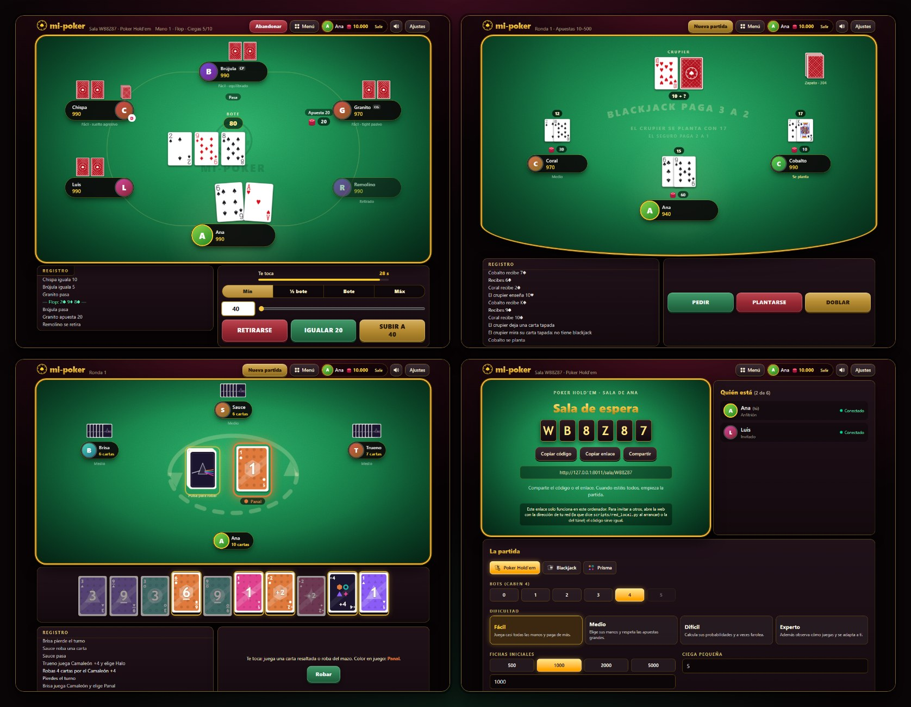
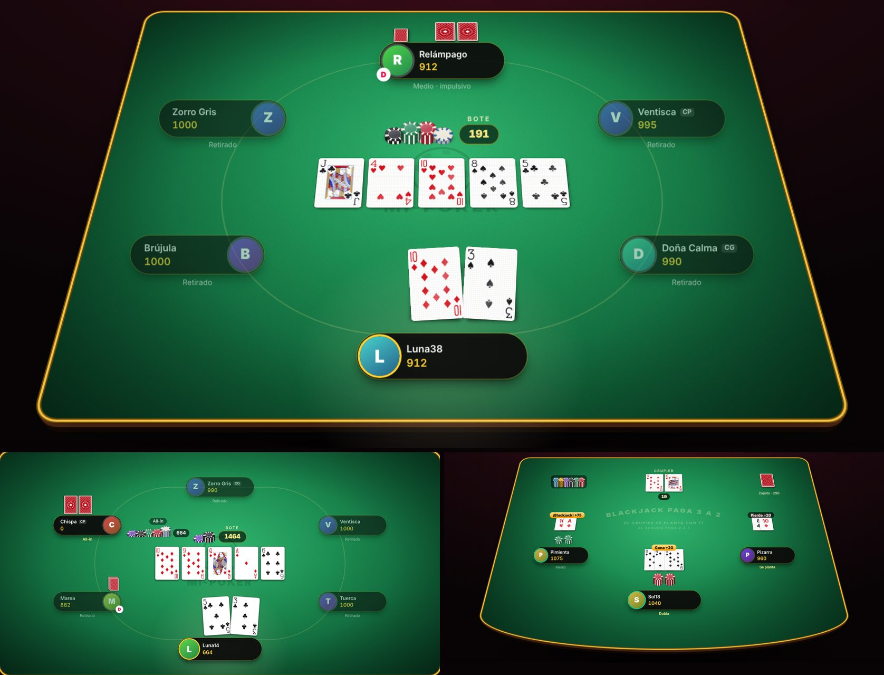

# mi-poker



Juegos de cartas para el navegador, contra bots o con tus amigos en salas
privadas: **Poker Hold'em**, **Blackjack** y **Prisma**, un juego de descarte
con las reglas del clásico y una identidad propia. Se elige a qué jugar en un
menú principal.

**Solo para entretenimiento. Sin dinero real.** Las fichas son virtuales y no
tienen ningún valor fuera del juego: no se compran, no se venden y no se
canjean por nada.

## Estado

- Etapa 1 (completa): motor de poker, bots con cuatro niveles de dificultad,
  servidor FastAPI + WebSocket e interfaz web.
- Etapa 2 (completa): pulido visual y sonoro: mesa con colores de casino,
  baraja clásica, animaciones, efectos de sonido y música.
- Etapa 3 (completa): cuentas, con perfil, estadísticas y saldo de fichas
  virtuales.
- Etapa 4 (completa): plataforma de juegos. Menú principal, el poker de
  siempre, blackjack y Prisma, cada juego como un módulo enchufable.
- Etapa 5 (completa): salas privadas para jugar con amigos (los tres juegos),
  cuentas obligatorias y fichas diarias. Se juega en la red de casa o, con un
  túnel, con amigos de fuera.
- Etapa 6 (completa): mesas en 3D, a elegir con las de siempre en 2D, con
  cartas que se mueven con física, y fichas de verdad en la mesa (apuestas que
  crecen, el bote y lo que se cobra), en las dos vistas.

Las partidas y las salas viven en la memoria del servidor y se pierden al
cerrarlo; las cuentas sí se guardan.

## Requisitos

- Python 3.12 o superior.
- Node.js LTS (para la interfaz web).

## Instalación

Desde la carpeta `backend`, en PowerShell:

```powershell
py -m venv .venv
.\.venv\Scripts\Activate.ps1
pip install -e ".[dev]"
```

Y la interfaz, desde la carpeta `frontend`:

```powershell
npm install
```

## Jugar

Forma simple: compilar la interfaz una vez y dejar que el servidor la sirva.

```powershell
cd frontend
npm run build
cd ..\backend
.\.venv\Scripts\Activate.ps1
uvicorn server.app:app
```

Abrir http://localhost:8000. La primera vez hay que crear una cuenta (ver
[Cuentas](#cuentas)). Después se abre el menú: una tarjeta por juego, con su
descripción y cuántos jugadores admite, y la tarjeta **Salas con amigos**. Cada
juego tiene su dirección propia (`/poker`, `/blackjack`, `/prisma`), así que
también se puede entrar directo o guardar el enlace.

Para desarrollar, con recarga automática, en dos terminales:

```powershell
# terminal 1, en backend (con el venv activado)
uvicorn server.app:app --reload
# terminal 2, en frontend
npm run dev
```

y abrir http://localhost:5173.

### El menú y las partidas

Arriba está siempre la misma cabecera: el nombre (que lleva al menú), el botón
**Menú**, la cuenta y los ajustes. Si sales de un juego con una partida en
curso, se pide confirmación; la partida no se pierde: queda en pausa y su
tarjeta del menú ofrece **Continuar partida**. Cada cuenta tiene una partida
por juego.

## Salas con amigos

Desde la tarjeta **Salas con amigos** del menú (o en `/salas`):

- **Crear una sala**: eliges el juego y recibes un código de 6 letras y
  números, por ejemplo `K7P2QX`, y un enlace (`/sala/K7P2QX`). Quien crea la
  sala es el anfitrión.
- **Unirse**: escribe el código en `/salas` (da igual en minúsculas o con
  guiones) o abre el enlace. Mientras se busca la sala sale "Buscando la
  sala…" y, al encontrarla, "¡Partida encontrada!".
- **La sala de espera** se actualiza sola: quién está y si está conectado, el
  código y el enlace para copiar, y las opciones. El anfitrión elige el juego,
  sus opciones y cuántos bots rellenan los sitios libres (las personas tienen
  preferencia), y empieza cuando hay al menos dos personas.
- **Durante la partida** cada uno ve solo lo suyo y tiene **30 segundos** para
  cada decisión. Si se acaban, el servidor juega por él lo más prudente: en el
  poker pasa o se retira; en el blackjack se planta (sin seguro), y quien no
  apuesta a tiempo no juega esa ronda; en Prisma roba y pasa. En el poker las
  manos se reparten solas, con una pausa entre una y otra.
- **Desconectarse no es irse**: si cierras la pestaña o se corta la conexión,
  tu sitio se guarda y vuelves con el mismo enlace (la tarjeta del menú te
  lleva a tu sala).
- **Abandonar** (salir de la sala con la partida empezada) tiene sus
  consecuencias: en el poker te retiras de la mano y pierdes lo apostado; en
  el blackjack tu ronda se juega sola; en Prisma un bot ocupa tu sitio. No se
  puede volver a esa partida.
- **Fichas**: poker y blackjack se juegan con el saldo de cada cuenta, también
  entre personas. Para empezar, cada uno tiene que tener libres las fichas
  iniciales de la mesa.
- Al terminar, la sala vuelve a la espera con la mesa final a la vista y el
  anfitrión puede empezar otra partida, también con gente nueva.

Cada persona está en una sola sala a la vez, y una sala sin nadie conectado
durante media hora se cierra sola.

## Jugar con otras personas

### En la red de casa (misma WiFi)

Desde `backend`, con el venv activado y la web compilada:

```powershell
python scripts\red_local.py
```

Dice dos direcciones: la de este ordenador y la de la red, por ejemplo
`http://192.168.1.20:8000`. Los demás abren esa dirección en su navegador
(móvil incluido). Ábrela tú también con esa dirección, no con `localhost`: el
enlace de la sala usa la dirección por la que has entrado. La primera vez,
Windows pregunta si Python puede recibir conexiones: permítelo solo en redes
privadas.

### Con amigos de fuera de casa (túnel)

Un túnel https temporal da a tu servidor una dirección en internet mientras
esté abierto. Por ejemplo, con Cloudflare, gratis y sin cuenta:

1. Descarga `cloudflared` de la web de Cloudflare (es un solo programa).
2. Con el servidor en marcha (`uvicorn server.app:app`), en otra terminal:

   ```powershell
   cloudflared tunnel --url http://localhost:8000
   ```

3. Al cabo de unos segundos escribe una dirección como
   `https://palabras-al-azar.trycloudflare.com`. Ábrela tú también (y entra en
   tu cuenta otra vez: cada dirección tiene su sesión), crea la sala desde ahí
   y comparte su enlace.

El túnel dura mientras esté abierta esa terminal; ciérralo al terminar. Quien
tenga la dirección puede llegar a la página de entrada, así que compártela
solo con tus amigos (para jugar hace falta cuenta igualmente). Otros túneles,
como `ngrok http 8000`, funcionan igual.

## Los juegos

### Poker Hold'em

Texas Hold'em No-Limit contra 1 a 5 bots. Se eligen el número de bots, la
dificultad, las fichas iniciales y las ciegas. Ciegas y botón que rota, side
pots, empates y eliminación como en las reglas oficiales.

### Blackjack

Tú contra el crupier, con 0 a 4 bots en los otros asientos.

- Zapato de 6 mazos. La carta de corte va hacia el 75 %: cuando sale, se
  termina la ronda y se rebaraja.
- El blackjack paga 3 a 2 y el empate devuelve la apuesta. Las apuestas van de
  10 en 10, entre la mínima y la máxima que elijas.
- Puedes pedir, plantarte, doblar (con las dos primeras cartas, también tras
  dividir) y dividir parejas hasta 4 manos; los ases divididos reciben una sola
  carta. Si el crupier enseña un As, se ofrece seguro (paga 2 a 1).
- Opciones: el crupier pide con 17 blando (por defecto se planta) y rendición
  tardía (por defecto no).
- El crupier mira si tiene blackjack cuando enseña un As o un 10. Su carta
  tapada no llega a tu navegador hasta que la destapa.

### Prisma

Las reglas del juego de descarte clásico, con nombre, cartas y vocabulario
propios.

- 108 cartas en cuatro palos, cada uno con su forma y su color (así también se
  distinguen sin ver los colores): **Panal** (hexágono, naranja cobre),
  **Halo** (anillo, turquesa), **Cumbre** (triángulo, violeta) y **Astro**
  (estrella, fucsia).
- En tu turno juegas una carta del mismo color, número o símbolo que la de la
  mesa, o un comodín. Si no puedes (o no quieres), robas una; si te sirve,
  puedes jugarla ya.
- **Pausa** salta al siguiente; **Remolino** cambia el sentido (con dos
  jugadores es como una Pausa); **Carga +2** hace robar 2 al siguiente, que
  pierde su turno. **Camaleón** cambia el color; **Camaleón +4** además hace
  robar 4, y solo se puede jugar sin cartas del color de la mesa: si se juega
  de farol, el siguiente puede desafiarlo.
- Al quedarte con una carta pulsa **¡Última!**. Si no lo haces y alguien te
  pilla antes de que juegue el siguiente, robas 2. Tú también puedes pillar a
  un bot despistado con **¡Pillado!**.
- Gana la ronda quien se queda sin cartas. Si se acaban las cartas que robar
  (y no queda nada que rebarajar) y nadie juega en una vuelta entera, la ronda
  se cierra y gana quien tiene menos cartas.
- Opciones: jugar a puntos hasta una meta, sin desafío del +4, y las opciones
  de la casa de acumular +2 y +4 (desactivadas por defecto).

## Cuentas

Para jugar hace falta una cuenta: sin sesión, cualquier página enseña la
pantalla de entrada. **Crear cuenta** pide solo un nombre de usuario (de 3 a 16
letras sin acento, números, guion o guion bajo) y una contraseña de al menos 8
caracteres. El correo es opcional y solo sirve para entrar con él en lugar del
nombre: no se verifica ni se usa para nada más, así que una contraseña
olvidada no se puede recuperar. **Entrar** acepta el nombre de usuario o el
correo.

Tu nombre de usuario es tu nombre en la mesa de todos los juegos. La sesión
dura 30 días en ese navegador, hasta que pulses **Salir**. Al pulsar tu nombre
se abre tu perfil, con las estadísticas del poker: manos jugadas y ganadas,
mayor bote, mejor mano enseñada y partidas ganadas, en total, según el nivel de
los bots y, aparte, las jugadas en salas ("Con amigos").

**Saldo**: cada cuenta tiene un saldo de fichas virtuales, que se ve junto a tu
nombre y empieza en 10.000. Poker y blackjack usan el mismo saldo: para jugar
eliges cuántas fichas llevas a la mesa, y lo que ganas o pierdes en cada mano o
ronda cambia el saldo al terminarla. Las fichas sentadas en una mesa no se
pueden llevar a otra a la vez. Si empiezas otra partida con una mano o ronda a
medias, pierdes lo que llevabas apostado en ella. Prisma no usa fichas.

**Fichas diarias**: cada vez que entras, si no tienes ya unas en camino, se
ponen en camino 10.000 fichas que llegan 24 horas después, aunque no estés
conectado. Si un día no entras, al día siguiente no llega nada. El menú, tu
perfil y la pantalla de inicio de cada mesa dicen cuándo llegan las próximas;
si pierdes todas tus fichas, toca esperar a esa entrega. No hay otra forma de
conseguir fichas.

Las cuentas se guardan en `backend/data/mi-poker.db` (SQLite), que se crea
solo la primera vez y no se sube a git. Para usar otro archivo, define la
variable `MI_POKER_DB` antes de arrancar el servidor. Borrar ese archivo
borra todas las cuentas; para guardar una copia de seguridad basta con
copiarlo con el servidor parado.

## Mesa en 2D o en 3D



Las mesas de los tres juegos se pueden ver de dos maneras, y cada uno elige:

- **2D**: la mesa plana, vista desde arriba, como siempre.
- **3D**: el tapete inclinado en perspectiva, con el canto de madera de la
  mesa. Las cartas tienen grosor, brillo de cartulina que cambia al pasar el
  ratón y su sombra en el paño. Se mueven con física: salen del mazo con un
  arco, giran en el aire, aterrizan con un rebote pequeño y frenan
  deslizando; al darse la vuelta se levantan por un borde, y al retirarse se
  deslizan por el tapete. Las placas con los nombres y los avisos van planas
  por encima, para que se lean siempre bien.

La primera vez, el menú pregunta cuál prefieres. Después se cambia cuando
quieras con el botón **2D / 3D** de la cabecera de cada mesa o en
**Ajustes → Mesa**. Se guarda en el navegador.

### Fichas en la mesa

En el poker y el blackjack (en las dos vistas) las apuestas son fichas de
verdad, con un color por valor: marfil (1), granate (5), verde (25), negro
(100), violeta (500), oro (1000) y azul (5000).

- **Poker**: cada apuesta vuela de la placa del jugador a su sitio en la mesa,
  y su pila crece con cada subida. Al cerrarse la ronda, las pilas se deslizan
  al bote, que va creciendo en el centro (el crupier cambia las fichas
  pequeñas por otras de más valor). Al final, el bote va entero al ganador,
  con sus mismas fichas, y al empezar la mano siguiente pasa a su placa.
- **Blackjack**: la apuesta va a su círculo; doblar pone otra pila igual al
  lado. El crupier paga desde su bandeja de fichas, o se lleva lo perdido a
  ella. El seguro va aparte. Al empezar otra ronda, lo que queda en la mesa
  vuelve a cada jugador.

Prisma no usa fichas.

Las animaciones mueven solo `transform` y `opacity`, para ir a 60 fotogramas
por segundo. Sin animaciones (en **Ajustes**, o si el sistema pide reducir el
movimiento) la mesa 3D se ve igual, pero quieta.

### Volver a como estaba (respaldo)

Si no te gusta el resultado, lo más sencillo es elegir **2D**: las cartas se
ven y se mueven exactamente como antes (lo único nuevo en 2D son las fichas).

Para volver al juego tal como estaba antes de esta etapa (sin 3D ni fichas),
está guardado en la rama `respaldo-antes-del-3d`. Desde la raíz del proyecto:

```powershell
git fetch origin
git switch respaldo-antes-del-3d
cd frontend
npm run build
```

y se arranca como siempre. Para volver a la versión nueva, `git switch main`
(o la rama en la que estuvieras) y otra vez `npm run build`.

## Sonido y ajustes

El audio empieza con tu primera interacción (un clic o una tecla): los
navegadores no dejan sonar nada antes. En la cabecera hay un botón para
silenciarlo todo y un menú **Ajustes** con el volumen de la música y el de los
efectos por separado. Ahí mismo se elige la vista de las mesas (2D o 3D) y se
pueden desactivar las animaciones: cada jugada se muestra entonces al instante
(por defecto se sigue la preferencia de movimiento reducido del sistema). Todo
se guarda en el navegador y vale para todos los juegos.

Los efectos y la música se generan por código, sin archivos. Si prefieres tu
propia música, guarda una pista como `frontend/src/assets/audio/music.mp3`
(o `.ogg`, `.wav`, `.m4a`) y vuelve a compilar: sustituye a la generada y se
repite con un fundido. Los detalles están en el `LEEME.md` de esa carpeta.

## Tests

Backend, desde `backend` con el venv activado:

```powershell
pytest
```

Cubren los tres motores, sus bots (con simulaciones que comprueban el orden de
los niveles), las partidas por WebSocket, las cuentas y las fichas diarias, el
registro de juegos, las salas (crear, unirse, la sala de espera, varias
personas en cada juego, tiempo por decisión y abandonos, con varios
navegadores de prueba a la vez) y una pasada de seguridad: entrar en partidas
o salas ajenas, mensajes rotos, inventados o enormes y cartas ocultas que
nunca llegan al navegador. Usan bases de datos temporales: nunca tocan la de
`backend/data`.

Frontend (líneas de tiempo, cola de reproducción, menú, panel de opciones,
textos, sonidos, cuentas, salas, la cámara 3D, la física de las cartas y las
fichas de la mesa: lo que no necesita navegador), desde `frontend`:

```powershell
npm test
```

Los tests de las líneas de tiempo y de las fichas usan partidas reales
grabadas del servidor: las fichas que se ven en cada paso cuadran siempre con
las apuestas, el bote y lo cobrado.
Para volver a grabarlas, desde la raíz del proyecto:

```powershell
backend\.venv\Scripts\python.exe frontend\tools\record_fixtures.py     # poker
backend\.venv\Scripts\python.exe frontend\tools\record_blackjack.py    # blackjack
backend\.venv\Scripts\python.exe frontend\tools\record_prisma.py       # Prisma
```

## Por consola

Desde `backend` con el venv activado:

```powershell
python scripts\demo_hand.py            # una mano de poker al azar, con todo su registro
python scripts\simulate.py             # poker: bb/100 de cada nivel (medio minuto)
python scripts\simulate_blackjack.py   # blackjack: lo que gana o pierde cada nivel
python scripts\simulate_prisma.py      # Prisma: partidas ganadas por cada nivel
python scripts\red_local.py            # el servidor para jugar en la red de casa
```

En todos el orden esperado es Experto > Difícil > Medio > Fácil (en el
blackjack, Difícil y Experto quedan casi iguales: los dos siguen la estrategia
básica y ninguno cuenta cartas).

## Bots

En todos los juegos los bots reciben solo lo que vería cualquier jugador (más
sus propias cartas) y "piensan" entre 0,8 y 2,5 segundos. Cambiar de nivel
cambia la estrategia, nunca la información.

| Nivel | Poker | Blackjack | Prisma |
|---|---|---|---|
| Fácil | Suelto y pasivo: juega casi todo y paga de más. | Decisiones a corazonadas. | Carta legal al azar; a menudo olvida «¡Última!». |
| Medio | Manos por su fuerza inicial y pot odds básicos. | Media estrategia básica. | Suelta primero lo que más vale; color: el que más tiene. |
| Difícil | Equity por Monte Carlo, posición y faroles ocasionales. | Estrategia básica completa. | Recuerda qué colores te faltan; guarda comodines y ataques. |
| Experto | Como Difícil, y se adapta a lo que haces. | Estrategia básica con ajustes por su mano. | Como Difícil, cierra mejor la mano y nunca se despista. |

## Estructura

```
backend/
  core/                piezas comunes en Python puro: baraja estándar, barajado
                       seguro, bots, opciones, la ficha de un juego y lo común
                       de las mesas de las salas (room.py)
  games/
    registry.py        EL REGISTRO: la lista de juegos que ve el menú
    poker/             engine/ (motor), bots/, session.py (la partida contra
    blackjack/         bots), room.py (la mesa de una sala), protocol.py
    prisma/            (mensajes), info.py (su ficha) y tests/, en cada juego
  accounts/            cuentas en Python puro: contraseñas, sesiones,
                       estadísticas, saldo y fichas diarias (SQLite)
  server/              FastAPI: partidas en memoria (partidas.py), salas
                       (salas.py y salas_api.py), WebSocket por partida y por
                       sala, API de juegos (games_api.py) y de cuentas
  data/                la base de datos de cuentas (se crea sola; fuera de git)
  scripts/             demos, simulaciones y el arranque en la red de casa
  tests/               tests de la plataforma (registro, partidas, salas, seguridad…)
frontend/
  src/hub/             el menú principal, construido con GET /api/juegos
  src/salas/           las salas con amigos: /salas, /sala/{código}, la sala de
                       espera y la animación de "¡Partida encontrada!"
  src/shared/          lo común: cabecera, cuenta, ajustes, sonido, movimiento,
                       baraja clásica, panel de opciones, cola de reproducción,
                       conexión con las partidas, cuenta atrás y tokens de diseño
                       (styles/tokens.css: colores, tipografías y espacios)
  src/shared/stage/    la mesa en 2D o 3D: la cámara, el escenario y la física
                       de las cartas
  src/shared/chips/    las fichas de la mesa: desglose, pilas y vuelos
  src/games/index.ts   el mapa de juegos: id → página, mesa de sala e ícono
  src/games/poker/     la mesa de poker (contra bots y en sala)
  src/games/blackjack/ la mesa de blackjack (contra bots y en sala)
  src/games/prisma/    la mesa de Prisma y sus cartas en SVG
  src/assets/          la baraja clásica (CC0) y la carpeta de música opcional
  tools/               graba partidas reales para los tests y prepara la baraja
docs/                  las imágenes de este README (capturas del juego)
```

Cada juego describe sus mensajes en su `protocol.py`; las rutas de partidas
están en `backend/server/games_api.py`, las de salas en
`backend/server/salas_api.py` y las de cuentas en
`backend/server/accounts_api.py`.

### Añadir un juego

1. Escribir su carpeta en `backend/games/<juego>/`: motor en Python puro,
   bots, partida (`session.py`), mensajes (`protocol.py`) y tests.
2. Escribir su ficha en `info.py` y añadirla al registro
   (`backend/games/registry.py`). El menú la mostrará solo.
3. Escribir su página en `frontend/src/games/<juego>/` y añadir una línea
   (página e ícono) en `frontend/src/games/index.ts`.
4. Para jugarlo en salas (opcional): sus opciones de sala (`RoomConfig` en
   `protocol.py`), su mesa con varias personas (`room.py`, a partir de
   `core/room.py`) en la ficha, y su vista `<Juego>Room.tsx` en el mapa de
   juegos.

El menú no se toca: se construye leyendo el registro.

## Cómo está hecho

### Partidas y seguridad

El servidor es la única autoridad: baraja con el generador seguro del sistema,
reparte, valida cada intención y paga. El navegador solo muestra el estado y
envía intenciones ("pedir carta", "jugar la carta 17").

- Para jugar, el navegador pide su partida por HTTP (`POST /api/partidas`) y se
  conecta a `/ws/{juego}/{partida_id}`. El id es largo, al azar y va ligado a
  su dueño: con el id de otro no se entra.
- Los mensajes se validan con modelos estrictos: un campo de más, un tipo
  equivocado o una acción inventada se rechazan sin tocar la partida.
- Nunca viajan las cartas ocultas: las de los rivales (hasta el showdown en el
  poker), la carta tapada del crupier, los mazos ni el zapato. Bots y
  navegador reciben la misma clase de vista, con solo lo público y lo suyo.
- Las peticiones y las conexiones desde otras webs se rechazan. Detrás de un
  túnel, la dirección que vio el navegador llega en `X-Forwarded-Host`, que una
  web ajena no puede poner.
- Los mensajes de más de 4 KB se rechazan sin leerlos.
- **Salas**: los códigos son al azar (casi 900 millones posibles) y, tras 10
  códigos inexistentes en un minuto desde la misma dirección, hay que esperar.
  A la sala en tiempo real solo se conectan sus miembros; cada persona recibe
  solo su vista de la mesa, y solo el anfitrión cambia las opciones o empieza.

Pensado para jugar en casa o con amigos a través de un túnel temporal. Antes de
publicarlo en internet de forma permanente haría falta, como mínimo, un
servidor con HTTPS propio y limitar cuántas cuentas se pueden crear.

### Cuentas y sesión

- **Contraseñas**: nunca se guardan. Se guarda un hash scrypt con una sal
  distinta por cuenta; el coste sigue la recomendación de OWASP.
- **Sesión**: al entrar, el servidor crea un token al azar y lo manda en una
  cookie `HttpOnly` y `SameSite=Lax`. En la base de datos solo queda el hash
  del token.
- **Quién soy**: lo decide el servidor al abrir la conexión con una partida o
  una sala. El nombre en la mesa lo pone el servidor.
- **Intentos fallidos**: el mensaje es el mismo exista o no el usuario, y tras
  cinco fallos en un minuto hay que esperar para volver a intentarlo.
- **Cerrar sesión** borra la sesión en el servidor y corta sus conexiones.
- **Saldo y estadísticas**: los apunta el servidor al terminar cada mano o
  ronda, antes de enviar el resultado; en pantalla el saldo no cambia hasta que
  la mesa ha terminado de mostrar cómo acabó.

### Cómo se reproduce una jugada

El servidor no envía sucesos sueltos: tras cada cambio envía la mesa completa,
con un registro de la mano o ronda que solo crece. Cada juego compara ese
registro con el anterior y lo convierte en pasos (repartir una carta, jugar,
robar, destapar…), que una cola común (`frontend/src/shared/timeline/`)
reproduce de uno en uno. Al vaciarse la cola, lo mostrado es exactamente el
estado del servidor, y solo entonces se activan los botones de acción.

### Cartas

- **Poker y blackjack**: la baraja clásica inglesa de Adrian Kennard, publicada
  como CC0 (dominio público) en https://www.me.uk/cards/, con figuras calcadas
  de una baraja Goodall & Son del siglo XIX. No lleva el nombre ni los dibujos
  de ninguna marca. Son dibujo propio el dorso, el adorno del as de picas y la
  cara sencilla de las cartas pequeñas. Para volver a preparar la baraja:
  `node frontend\tools\import_cards.mjs <carpeta con los SVG descargados>`.
- **Prisma**: cartas dibujadas por código en SVG (`frontend/src/games/prisma/`),
  de diseño propio: marco claro, campo del color del palo con una banda
  diagonal, la forma del palo de fondo, números rectos y símbolos propios para
  cada acción. El reverso es un prisma que abre la luz en los cuatro colores.

### Animaciones

En 2D, las cartas se mueven al estilo de Balatro, con nuestro propio dibujo:
salen volando del mazo (o del zapato), las tuyas se voltean en 3D al llegar y,
en reposo, flotan apenas. Solo se animan `transform` y `opacity`, y cada
movimiento dura menos de medio segundo. Con las animaciones desactivadas en
**Ajustes** (o si el sistema pide movimiento reducido) no se mueve nada.

En 3D (`frontend/src/shared/stage/`), la mesa es el mismo lienzo inclinado con
la propiedad `perspective` del navegador; una cámara repite sus cuentas para
colocar encima, planos, los nombres y los avisos, y para saber de dónde sale
cada carta. Los movimientos de las cartas salen de una pequeña simulación
(lanzamiento, aire, rebote y rozamiento) convertida en fotogramas clave, así
que el navegador solo tiene que interpolar. Para ir fluido, en 3D no hay nada
que se mueva sin parar sobre el tapete (las cartas descansan quietas, como las
de verdad) y las sombras son imágenes ya desenfocadas.

Las fichas (`frontend/src/shared/chips/`) se dibujan con CSS como cilindros
apilados. Lo que hay en la mesa se calcula a partir del registro de la mano,
igual que los pasos de la reproducción; las que cruzan la mesa son copias que
vuelan por encima, y las que llegan a una pila caen en ella al llegar.

### Sonido

El juego no trae ningún archivo de audio: cada efecto y la música se sintetizan
en el momento con la Web Audio API (`frontend/src/shared/audio/`); la única
excepción es la pista opcional que puedes poner tú. Con la pestaña oculta no
suena nada.

## Créditos

- Caras de la baraja clásica: Adrian Kennard, CC0 (dominio público),
  https://www.me.uk/cards/. Detalles en `frontend/src/assets/cards/LEEME.md`.
- Todo lo demás (nombre, emblemas, íconos, cartas de Prisma, dorsos, mesas,
  avatares, textos, efectos de sonido y música) es propio de este proyecto.
